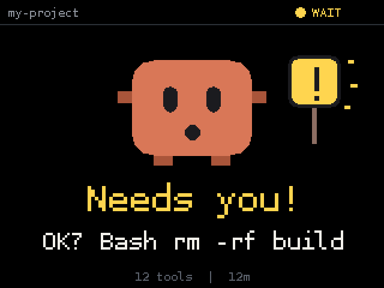
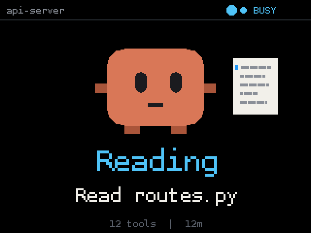
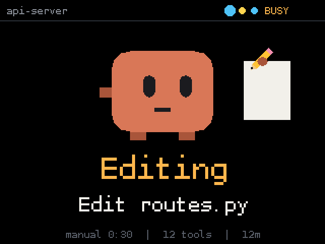
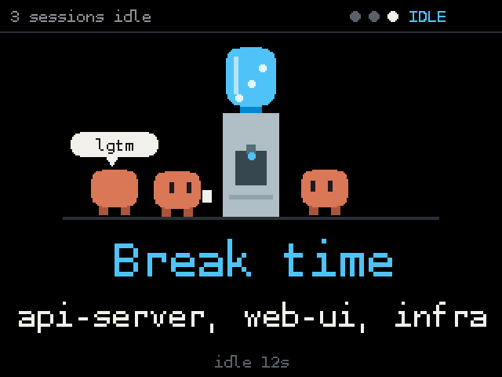

# Claude Desktop Buddy (PyPortal)

An animated buddy on an Adafruit PyPortal that shows what Claude Code is doing.
When Claude has been idle for 3 minutes, the screen falls back to a weather
display. The PyPortal doesn't use Wi-Fi: the bridge on the PC fetches the weather
and the local time and sends both over USB. While Spotify is playing, the buddy wears headphones. If
Claude is idle, the screen shows the buddy listening, with the song and artist,
instead of the weather.

```
Claude Code hooks (WSL)          Windows                      PyPortal (COM3 / G:)
host/pyportal_hook.py  ──append──► ~/.claude/pyportal/events.jsonl
                                    │ tail -F
                                    ▼
                         host/pyportal_bridge.py (python.exe + pyserial)
                                    │ JSON line state snapshots over USB serial
                                    ▼
                         device/code.py + device/claude_buddy.py
```

## Pieces
- `device/`: CircuitPython code (`code.py`, `claude_buddy.py`, `weather_view.py`). It uses the fonts, icons and `weather_background.bmp` that are already on the device. Deploy with `./deploy.sh`, which finds the CIRCUITPY drive automatically.
- `host/pyportal_hook.py`: registered for the SessionStart, UserPromptSubmit, Pre/PostToolUse, Notification, Stop, SubagentStop, PreCompact and SessionEnd hooks in `~/.claude/settings.json`. It also starts the bridge if it isn't running.
- Spotify: the bridge reads Windows' now-playing info (the same info as the volume flyout), so Spotify has to be playing on this PC. It needs `python.exe -m pip install winrt-Windows.Media.Control winrt-Windows.Foundation winrt-Windows.Foundation.Collections`. Without those packages the bridge still runs, just without music. To watch other players, change `MUSIC_APPS` in `pyportal_bridge.py`.
- Weather: the bridge fetches OpenWeather every 10 minutes. It needs `host/weather_config.json` (gitignored), containing `{"token": "<OpenWeather API key>", "location": "Richmond,US", "units": "imperial"}` (`units` can be `metric`). Without that file the bridge still runs, but the weather screen stays on "Waiting for weather". The bridge also sends the PC's local time, which sets the PyPortal's clock. Weather updates only arrive while the bridge is running, and a Claude Code hook starts the bridge.
- `host/start_bridge.sh`: start the bridge. Use `--stop` to stop it, or `--fg` to run it in the foreground. Log: `~/.claude/pyportal/bridge.log` (includes everything the PyPortal prints).
- `tools/render_gifs.py`: renders the animations to `docs/animations/` on your computer, no PyPortal needed. It runs the real `device/claude_buddy.py` and draws it with Pillow. Run `python3 -m venv .venv && .venv/bin/pip install pillow` once, then `.venv/bin/python tools/render_gifs.py` (add scene names to render just those). Re-run it after changing an animation.
- `pyportal_backup_*/`: the original device contents. It includes `secrets.py` (Wi-Fi password and API key), so don't commit or share it.

## Buddy states
GIFs of every state are in [docs/animations](docs/animations/README.md).

  

| State | Trigger | Animation |
|---|---|---|
| Hello | session start | waving |
| Thinking | prompt submitted / between tools | hand on chin; bubble cycles ... ? cog; light bulb when it starts a tool |
| Reading | Read, Grep, Glob | eyes scan a page |
| Editing / Planning | Edit, Write / TodoWrite | writes the page with a pencil; full pages slide away |
| Running | Bash | types the real command on a keyboard; output scrolls in |
| Browsing | WebFetch, WebSearch | spinning globe |
| Delegating | Agent / Task | bouncing mini-buddies |
| Needs you! | permission prompt | hops, flaps arms, waves a `!` sign, flashes yellow, NeoPixel blinks |
| Your turn | idle notification | `?` |
| All done | Stop | happy face, sparkles |
| Goodnight | session end | zzz |
| Break time | 2+ sessions, all idle | mini buddies (one per session) chat around a water cooler; bubbles glug, a drip falls, one sips from a cup |
| Listening | Spotify playing, Claude idle | headphones, swaying, floating notes, song + artist |

## Multiple sessions
The bridge tracks every Claude Code session and shows one at a time:
- **Priority**: needs approval > finished but not yet shown > waiting for your reply > working > idle. A higher-priority session takes the screen straight away.
- **Hold**: a session keeps the screen for at least 5 s before another session of equal priority can take over. A finished session shows "All done" for 10 s before it counts as seen.
- **Dots**: with more than one live session, the header shows one dot per session (yellow = needs you, green = done, white = your turn, blue = working, grey = idle). The bigger dot is the session on screen.

- **Water cooler**: when two or more sessions are all idle (and each one's "All done" has been shown), the screen shows them on a break at a water cooler. The weather takes over 3 minutes after the last activity, as with a single session.
- **Tap to switch**: tap the screen to show the next session (in dot order). The choice lasts 30 s, every tap restarts the timer, and the footer counts down (`manual 0:25`). After that, automatic mode takes over again. During an override, a permission prompt in another session doesn't take the screen: it shows as a yellow dot, and the NeoPixel blinks yellow. Taps are ignored on the weather and Spotify screens, and when only one session is live.

Tune `MIN_HOLD`, `DONE_HOLD`, `LIVE_FOR` and `OVERRIDE` in `host/pyportal_bridge.py`.

  

## Restore the original weather-only app
Copy `pyportal_backup_*/code.py` back onto the CIRCUITPY drive. That app uses Wi-Fi and `secrets.py` again.

## Undo the hooks
Restore `~/.claude/settings.json.bak-pyportal`, or delete the `pyportal_hook.py` entries under `"hooks"`.
