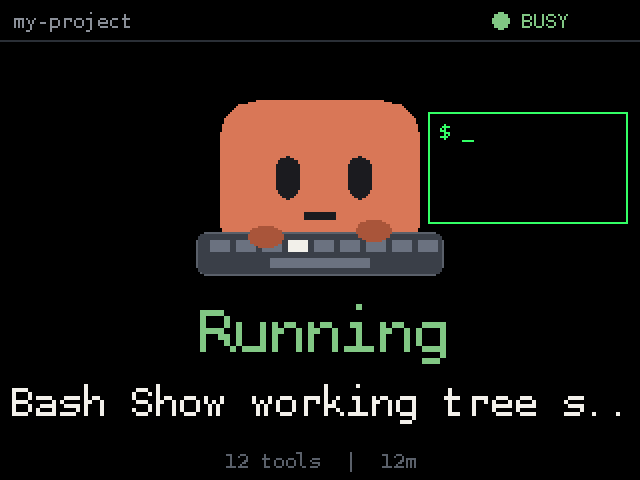
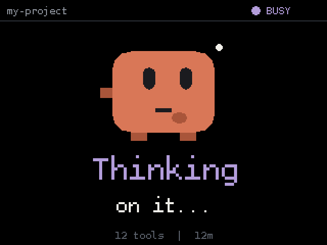

# Claude Desktop Buddy (PyPortal)

An animated buddy on an Adafruit PyPortal that shows what Claude Code is doing.
When Claude has been idle for 1 minute, the screen falls back to the original
OpenWeather display. While Spotify is playing, the buddy wears headphones. If
Claude is idle, the screen shows the buddy listening, with the song and artist,
instead of the weather.

```
Claude Code hooks (WSL)          Windows                      PyPortal (COM3 / G:)
host/pyportal_hook.py  ──append──► ~/.claude/pyportal/events.jsonl
                                    │ tail -F
                                    ▼
                         host/pyportal_bridge.py (python.exe + pyserial)
                                    │ JSON line state snapshots over USB serial
                                    ▼
                         device/code.py + device/claude_buddy.py
```

## Pieces
- `device/`: CircuitPython code. Deploy with `./deploy.sh`, which finds the CIRCUITPY drive automatically.
- `host/pyportal_hook.py`: registered for the SessionStart, UserPromptSubmit, Pre/PostToolUse, Notification, Stop, SubagentStop, PreCompact and SessionEnd hooks in `~/.claude/settings.json`. It also starts the bridge if it isn't running.
- Spotify: the bridge reads Windows' now-playing info (the same info as the volume flyout), so Spotify has to be playing on this PC. It needs `python.exe -m pip install winrt-Windows.Media.Control winrt-Windows.Foundation winrt-Windows.Foundation.Collections`. Without those packages the bridge still runs, just without music. To watch other players, change `MUSIC_APPS` in `pyportal_bridge.py`.
- `host/start_bridge.sh`: start the bridge. Use `--stop` to stop it, or `--fg` to run it in the foreground. Log: `~/.claude/pyportal/bridge.log` (includes everything the PyPortal prints).
- `tools/render_gifs.py`: renders the animations to `docs/animations/` on your computer, no PyPortal needed. It runs the real `device/claude_buddy.py` and draws it with Pillow. Run `python3 -m venv .venv && .venv/bin/pip install pillow` once, then `.venv/bin/python tools/render_gifs.py` (add scene names to render just those). Re-run it after changing an animation.
- `pyportal_backup_*/`: the original device contents. It includes `secrets.py` (Wi-Fi password and API key), so don't commit or share it.

## Buddy states
GIFs of every state are in [docs/animations](docs/animations/README.md).

  

| State | Trigger | Animation |
|---|---|---|
| Hello | session start | waving |
| Thinking | prompt submitted / between tools | hand on chin; bubble cycles ... ? cog; light bulb when it starts a tool |
| Reading | Read, Grep, Glob | eyes scan a page |
| Editing / Planning | Edit, Write / TodoWrite | writes the page with a pencil; full pages slide away |
| Running | Bash | types the real command on a keyboard; output scrolls in |
| Browsing | WebFetch, WebSearch | spinning globe |
| Delegating | Agent / Task | bouncing mini-buddies |
| Needs you! | permission prompt | hops, flaps arms, waves a `!` sign, flashes yellow, NeoPixel blinks |
| Your turn | idle notification | `?` |
| All done | Stop | happy face, sparkles |
| Goodnight | session end | zzz |
| Listening | Spotify playing, Claude idle | headphones, swaying, floating notes, song + artist |

## Restore the original weather-only app
Copy `pyportal_backup_*/code.py` back onto the CIRCUITPY drive.

## Undo the hooks
Restore `~/.claude/settings.json.bak-pyportal`, or delete the `pyportal_hook.py` entries under `"hooks"`.
