# Buddy animations

Rendered from `device/claude_buddy.py` by `tools/render_gifs.py` (regenerate after changing animations). The font is an approximation of the PyPortal's built-in one.

## One session

| | |
|---|---|
| **Hello: session start** 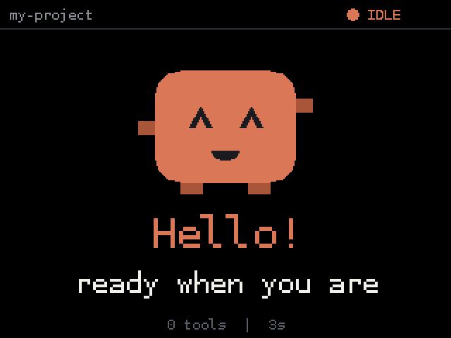 | **Thinking, then the light bulb as it starts a tool** 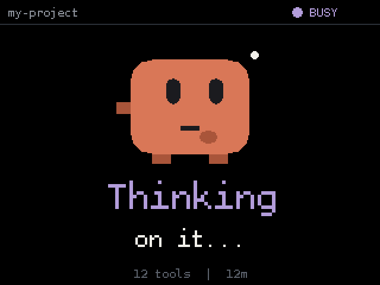 |
| **Reading: Read / Grep / Glob** 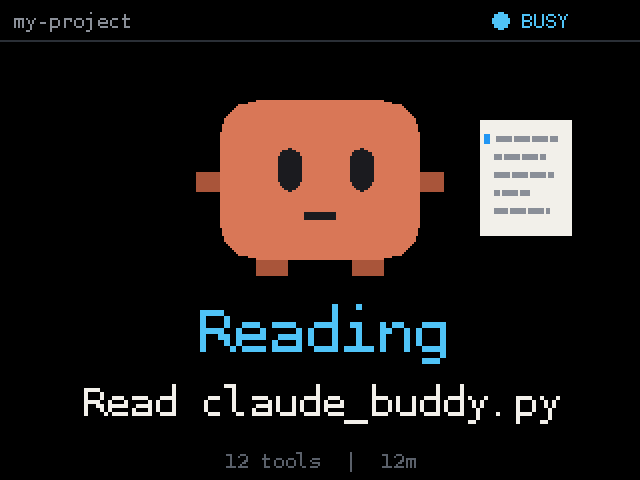 | **Editing: Edit / Write** 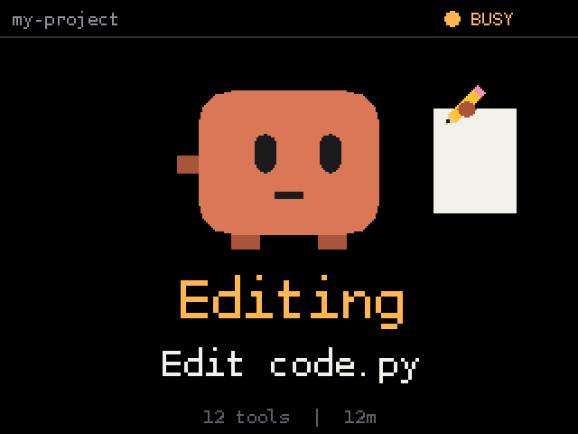 |
| **Planning: TodoWrite** 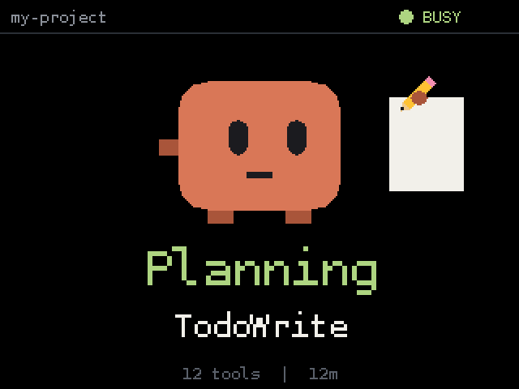 | **Running: Bash, typing the real command** 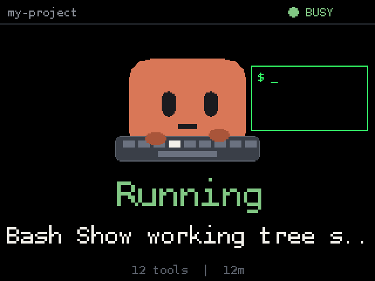 |
| **Running: a long command wraps** 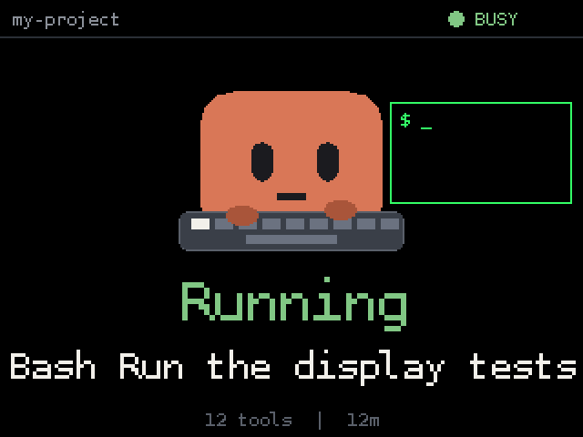 | **Browsing: WebFetch / WebSearch** 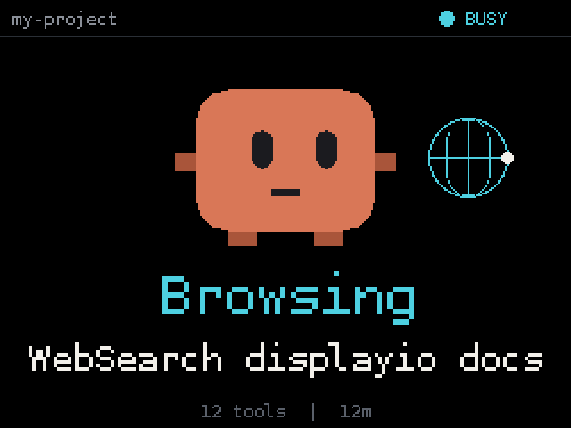 |
| **Delegating: Agent** 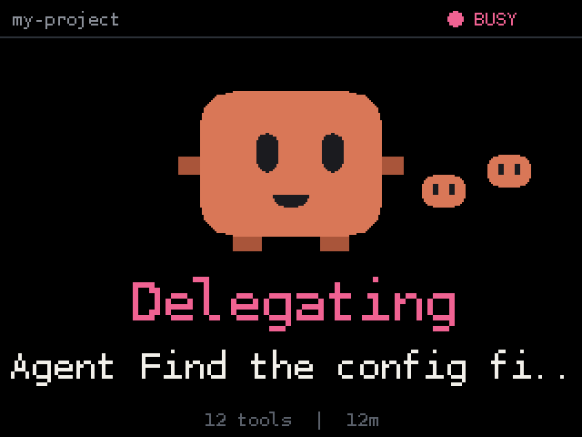 | **Using a tool: anything else** 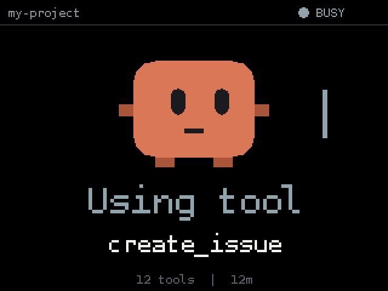 |
| **Needs you!: permission prompt** 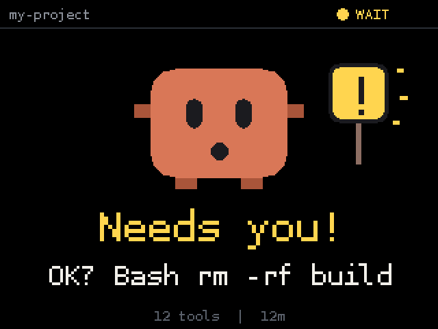 | **Your turn: idle notification** 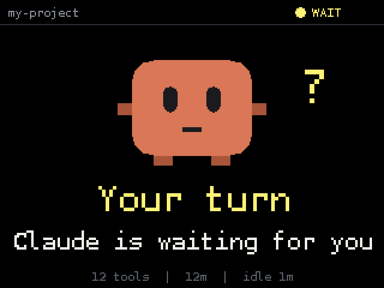 |
| **All done: Stop** 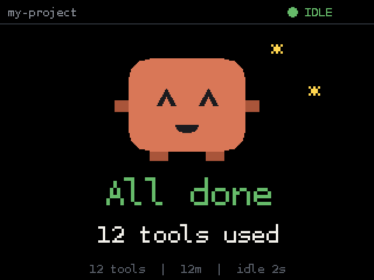 | **Compacting: PreCompact** 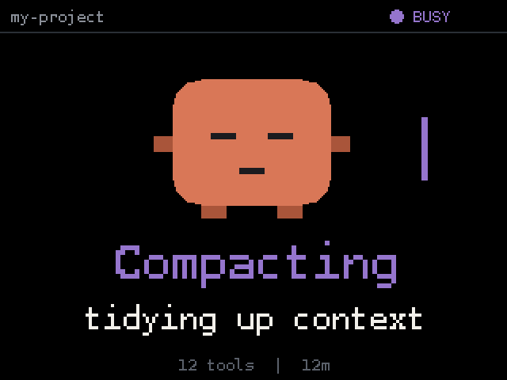 |
| **Goodnight: session end** 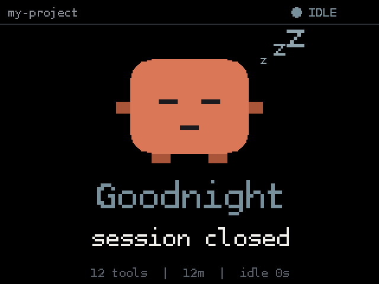 | **Listening: Spotify playing, Claude idle** 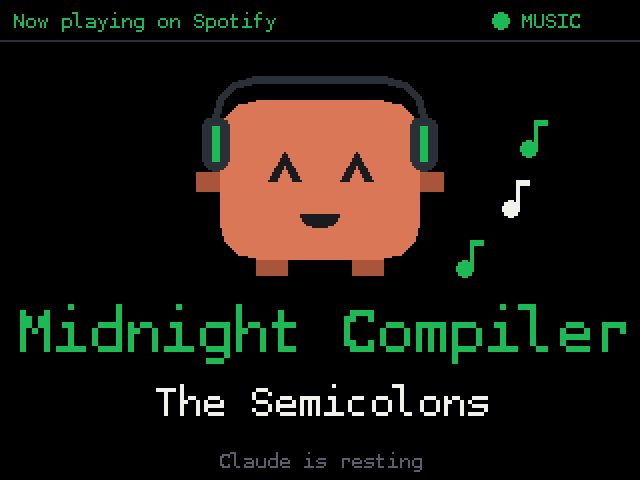 |
| **Headphones on while Claude works** 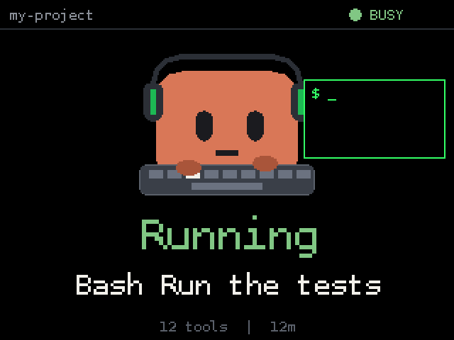 |  |

## Multiple sessions

With two or more live sessions, the header shows one dot per session (yellow = needs you, green = done, white = your turn, blue = working, grey = idle); the bigger dot is the session on screen. Tap the screen to show the next session for 30 s. When every session is idle, they take a break at the water cooler.

| | |
|---|---|
| **Three sessions: dots show each one, the big dot is on screen** 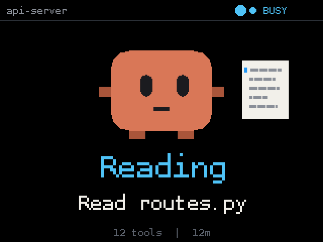 | **Tapped to another session: manual for 30 s, yellow dot still waiting** 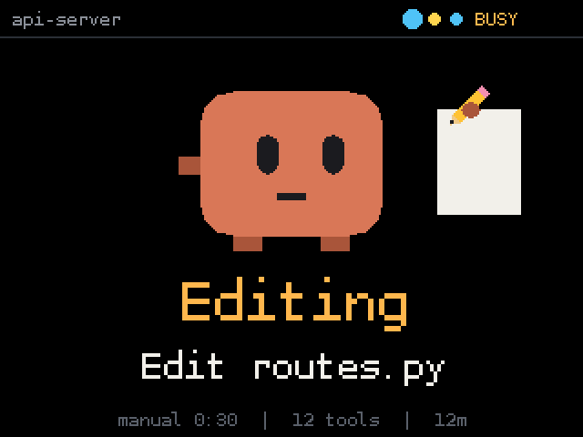 |
| **Water cooler: every session is idle** 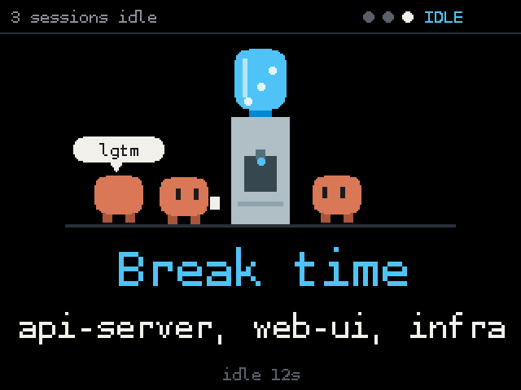 |  |
